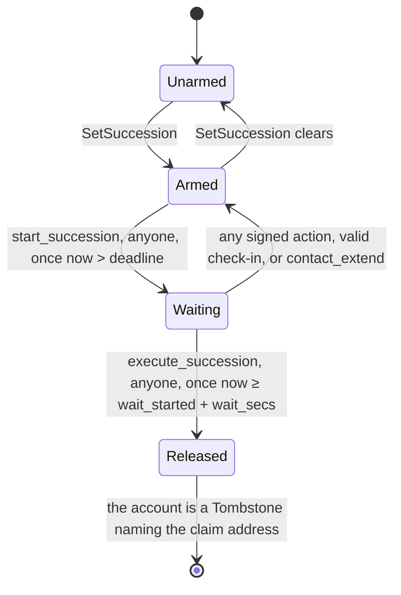

# Lamport Heir: design note (milestone 0)

2026-11-13. Maps the [Lamport Heir spec](https://claude.ai/artifact/G1AFWhoqMZqufobPxZRNuC) onto the
code it builds on, and lists what in the spec does not fit that code.

| repository | commit read | moved since the spec? |
|---|---|---|
| [lamport-vault](https://github.com/Lamport-Robotics/lamport-vault) | `c4a4ccd` (Anchor 0.32.1) | no |
| [pincer1](https://github.com/Lamport-Robotics/pincer1) | `c4b2d62` | no |

File and line references below are at those commits. Where this note and the spec disagree about
what the code does, the code was read, and for the vault's build, measured.

## 1. Summary

**What fits.** The vault half of the spec maps cleanly onto the vault as it is:

- `Close`, the tombstone, `sweep_closed` and `sweep_closed_sol` do what the spec says, and the sweeps
  work unchanged for a release to a program-derived address.
- The vault's key derivation already binds the program id, so a vault under a second program id gets
  different LMS keys from the same 24 words. The same words do not put one key under both programs.
- The succession feature can be added to the vault crate **without changing one byte of today's
  program**. That was measured, not assumed (section 3.1). It needs an unusual editing rule.
- Pincer1's switch behaves as the spec describes: the timer and the signed transaction live on the
  controller, the heir must be an ordinary address, and tokens are classic SPL only.

**What does not fit, and needed a decision before the milestone it blocks.** Each item has a
recommended answer. On 2026-11-13 the project owner left all eight to the builder, and each was
decided as recommended: [`decisions.md`](decisions.md).

| # | finding | blocks | recommended |
|---|---|---|---|
| 1 | Pincer1's daemon serves `/inheritance*` and `/offline/nonce/create` to callers on the robot only. A pairing token does not open them (section 7.2) | M5 | run the Pincer1 link on the robot itself, or change the daemon; the second breaks a hard constraint |
| 2 | The 30-day queue for plan changes cannot change who is paid or when. Every change is a signed action, which resets a clock whose shortest window (90 days) outlasts the queue (section 4.4) | M2 | drop the queue; changes apply at once; test the 120-day rule that actually protects |
| 3 | Sharing code with `Close` would move its lines, which changes the vault's bytes. The release needs its own copy of that path (section 4.6) | M2 | own copy, plus a test that both paths leave identical accounts |
| 4 | The vault page and the cold signer know one program id and four actions. Signing `SetSuccession` "with the existing signing flow" needs changes to `web/` and the SDK in lamport-vault (section 4.8) | M2, M4 | add them in the M2 vault pull request |
| 5 | Two gates need clock control the tools do not give: a local validator cannot jump its clock, and devnet cannot run 90- and 30-day floors in a test (section 4.9) | M2 to M4 | LiteSVM for clock jumps; a test-only `short-clocks` build under its own program id for devnet |
| 6 | Heirs "must sign `init_plan`" makes plan creation a transaction several people sign inside one blockhash lifetime, and it publishes the heir, which defeats the hashed-heirs option (section 5.2) | M1 | proof by a signed message the program checks |
| 7 | The contact's 90 days: the spec's formula adds them to every later deadline for good, and buys little if the waiting period was opened late (section 4.5) | M2 | the extension lasts until the owner is next active, and is measured from the moment it is used |
| 8 | Program ids for the Heir-enabled vault and the claim program (section 4.7) | M1, M2 on devnet | you generate the keypairs and send the public keys; local tests use throwaway ids until then |

Smaller points that change no behaviour you chose are collected in section 8.

## 2. The vault as it is

### 2.1 Accounts

`programs/lamport-vault/src/state.rs`. All three accounts are Borsh behind an 8-byte Anchor
discriminator.

**`Vault`**, PDA `["vault", vault_id]` with `vault_id = sha256(initial lms_pubkey)` (`state.rs:28`):

| offset | field | bytes | |
|---|---|---|---|
| 0 | discriminator | 8 | `sha256("account:Vault")[..8]` |
| 8 | `version` | 1 | 2 today (`Vault::VERSION`, `state.rs:98`) |
| 9 | `bump` | 1 | |
| 10 | `vault_id` | 32 | never changes, so the address never changes |
| 42 | `lms_pubkey` | 56 | the current key |
| 98 | `spent` | 4 | leaves spent under the current key |
| 102 | `generation` | 4 | key rotations so far; part of every signed message |
| 106 | `created_slot` | 8 | |
| 114 | `used` | 4 + 2^h/8 | used-leaf bitmap: 4, 128 or 4 096 bytes |
| … | `used_keys` | 4 + 16·n | hashes of past keys, at most 128 |

The first 114 bytes are fixed (`Vault::FIXED`). Everything after them moves when the bitmap size or
the key history differs.

**`Tombstone`**, what `Close` leaves at the same address (`state.rs:161`): discriminator, `version`
`0xFE`, `vault_id`, `closed_slot`, `heir`. 81 bytes, holding exactly its rent. `heir` is the only
place `sweep_closed` and `sweep_closed_sol` will ever send anything.

**`SigBuffer`**, PDA `["sig", vault, payer, nonce]` (`state.rs:228`): staging for one signature,
because a 2.3 to 2.8 KB LMS signature does not fit a legacy transaction.

### 2.2 How an action is encoded

`programs/lamport-vault/src/action.rs:20`. A Borsh enum: one byte of variant index, the fields in
order, integers little-endian. Every variant ends in `issued_slot: u64, expiry_slot: u64`.

| index | variant | bytes |
|---|---|---|
| 0 | `TransferSol { to, lamports }` | 57 |
| 1 | `TransferToken { mint, to, amount }` | 89 |
| 2 | `Rotate { new_lms_pubkey }` | 73 |
| 3 | `Close { to }` | 49 |
| 4 | `TransferTokenFrom { from, mint, to, amount }` | 121 |

`Action::decode` refuses trailing bytes (`action.rs:88`). A staged action may be at most 256 bytes
(`MAX_ACTION_LEN`). The SDK mirrors the encoding by hand in `sdk/packages/vault/src/action.ts`; there
is no generated client.

### 2.3 How it is staged and verified

Two ways in, one code path (`verify_and_act`, `lib.rs:244`):

- **staged:** `open_sig_buffer(nonce, action, sig_len, first_chunk)` (`lib.rs:464`), then `write_sig`
  until the buffer is full, then `execute()` (`lib.rs:520`). Anyone may call `execute`.
- **direct:** `execute_direct(action, signature)` (`lib.rs:534`), one transaction, on clusters with
  transaction v1.

`verify_and_act` then does, in this order:

1. `message = sha256("lamport-vault/v1" ‖ program_id ‖ vault ‖ u32le(generation) ‖ action_bytes)`
   (`signed_message`, `lib.rs:75`). The program id in it is the program's own `ID`.
2. Parse the signature against the vault's key, refuse a spent leaf, verify
   (`verify_action_signature`, `lib.rs:114`).
3. Mark the leaf spent (`lib.rs:254`).
4. Decode the action, check the validity window against `Clock.slot`, apply the exhaustion rule
   (`check_action`, `lib.rs:144`): the last free leaf may only `Rotate` or `Close`.
5. Perform it (`lib.rs:269` to `410`).

The window rule (`check_validity_window`, `lib.rs:133`): not issued in the future, not expired, and
`expiry_slot − issued_slot ≤ 216 000` slots, about a day. So nothing can be signed ahead for an heir,
which is why the vault needs a clock of its own.

### 2.4 Close and the sweeps

- **`Close { to }`** is the match arm at `lib.rs:365` to `409`. It requires `to` to be the first
  remaining account, refuses the vault itself and the staging buffer, closes any *empty* vault token
  accounts passed in as `[token account, token program]` pairs, moves every lamport above a
  tombstone's rent to `to`, shrinks the account to 81 bytes and writes the tombstone with
  `heir = to`.
- **`sweep_closed`** (`lib.rs:558`) is permissionless. For one token account the closed vault still
  owns, it creates the heir's associated token account if missing, moves the whole balance there,
  and closes the vault's account, its rent to the heir. The associated-token program accepts an
  off-curve owner on chain, so this works when the heir is a program-derived address: the vault's
  suite creates the vault's own token accounts that way (`tests/lamport-vault.ts:448`). It has no
  test that sweeps to a program-derived heir yet; milestone 1 adds one. Remaining accounts go to
  the token program as they are, for transfer hooks.
- **`sweep_closed_sol`** (`lib.rs:624`) is permissionless and moves lamports that reach the
  tombstone later to the heir.

Nothing in these three checks who the heir *is*. A release to a claim-program plan account reuses
them unchanged, as the spec says.

### 2.5 Keys, program ids and the SDK

- Derivation (`docs/SPEC-DERIVATION.md`, `sdk/packages/lms/src/derive.ts:138`) feeds
  `genesis_hash ‖ program_id ‖ index` into HKDF. The same words under another program id are
  different keys.
- Every SDK builder and `VaultSigner` take a `programId` (`sdk/packages/vault/src/signer.ts:385`).
- The vault page and the cold signer do not: `web/src/app.ts:30` and `web/src/signer.ts:161` use the
  constant `LAMPORT_VAULT_PROGRAM_ID`, and both render exactly four actions.
- The devnet program is upgradeable; mainnet has no deployment. `docs/VERIFY.md` records the devnet
  hash `b9c055c3…2a563b`.

## 3. How the feature goes in

### 3.1 The default build is sensitive to line numbers

The hard constraint is that the vault without the feature builds to exactly what it is today. That
is stricter than "no behaviour change": the program contains its own line numbers. Anchor's
`require!` and `error!` compile `file!()` and `line!()` into the error they return, and overflow
checks carry their source location.

Measured on GitHub's runners with `solana-verify` 0.5.2 in the image `verify.yml` pins
([run](https://github.com/TSchonleber/lamport-vault/actions/runs/43371447105)):

| variant of `c4a4ccd` | hash of the default build |
|---|---|
| unchanged | `b9c055c3…2a563b`, 341 968 bytes: the hash in `docs/VERIFY.md` |
| one blank line near the top of `lib.rs` | `4d309fc1…de3547` |
| one blank line after the `#[program]` module, above the account structs | `223d12bc…080fa3` |
| prototype hooks, with a feature-only instruction on new lines inside `#[program]` | `eb786379…44f541` |
| the same prototype with every insertion at the end of an existing line or file | `b9c055c3…2a563b`, identical |

The prototype in the last two rows is a stand-in for milestone 2, not milestone 2: a feature-only
`Action` variant, `Vault` field, layout version, match arm in `verify_and_act`, hook after a signed
action, instruction in `#[program]`, second `declare_id!`, and a new module
([diff](https://github.com/TSchonleber/lamport-vault/compare/main...spike/hooks-noshift)). With the
feature on it builds to 351 400 bytes.

So the feature can reach into the middle of the vault's code without changing the vault, on one
condition: **no existing line of `programs/lamport-vault/src/*.rs` moves.** New code goes in new
files; whole items are appended at the end of a file; a feature-only member of an existing item goes
at the end of an existing line behind `#[cfg(feature = "succession")]`. Those lines get long. The
vault repository's `docs/SUCCESSION.md` states the rule and `succession.yml` enforces it by building
both and comparing the files.

### 3.2 Where milestone 2 will hook in

| where (at `c4a4ccd`) | what is added, feature only |
|---|---|
| `lib.rs:27` `declare_id!` | a second id for the Heir-enabled program |
| `state.rs:43` after `created_slot` | the `succession` block, at fixed offset 114 |
| `state.rs:98` `VERSION` | 3 |
| `state.rs:110` `space()` | `+ Self::EXT`, which is 0 without the feature |
| `action.rs:83` after variant 4 | `SetSuccession`, variant 5 |
| `action.rs:109` `window()` | its arm |
| `lib.rs:409` after the `Close` arm | the `SetSuccession` arm |
| `lib.rs:411` before `Ok(())` | the hook that records `last_signed_ts` and cancels a waiting period |
| `lib.rs:453` `create_vault` | the empty block |
| `lib.rs:634` end of `#[program]` | `checkin`, `contact_extend`, `start_succession`, `execute_succession` |
| end of `lib.rs` | `pub mod succession;` (already there after milestone 0) |

Everything else, including the account structs for the new instructions, the rules and the errors
(numbered from 6100, so `error.rs` is not touched), lives in `succession.rs`. As built, the errors
are a hand-written type and not a second `#[error_code]` enum: Anchor's IDL holds one error list
per program, and a second enum replaced the vault's own list there
([`decisions.md`](decisions.md), milestone 2).

`check_action` is deliberately not on the list. Its exhaustion rule stays as it is, so the last free
leaf still only does `Rotate` or `Close`, and `SetSuccession` is refused on it.

## 4. Succession in the vault (milestone 2)

### 4.1 State

A fixed-size block, present in every vault of the Heir-enabled program from creation and all zero
until armed. Fixed size means arming never reallocates. Fixed offset 114 means the finisher and the
reminder service can read every plan with one `getProgramAccounts` and a `dataSlice`, without
parsing bitmaps.

| field | type | |
|---|---|---|
| `claim` | Pubkey | the default address means not armed |
| `window_secs`, `wait_secs` | u64 | at least 90 and 30 days |
| `last_signed_ts` | i64 | when the last signed action executed |
| `last_checkin_ts` | i64 | when the last valid check-in executed |
| `checkin_key` | Pubkey | default address means none |
| `contact_key`, `contact_used` | Pubkey, u8 | |
| `extension_secs` | u64 | |
| `wait_started_ts` | i64 | 0 means no waiting period |
| `pending_claim`, `pending_window_secs`, `pending_wait_secs`, `pending_effective_ts` | Pubkey, u64, u64, i64 | only if the queue stays (section 4.4); `pending_effective_ts = 0` means nothing queued |
| `flags`, reserved | u8, bytes | |

About 220 bytes, 0.0015 SOL of extra rent per vault, paid at creation. `Rotate` keeps it: the block
sits before the two vectors, and `Rotate` only grows the second.

### 4.2 `SetSuccession`

Variant 5 of `Action`, staged and executed like every other action:

```
5 SetSuccession { claim: Pubkey, window_secs: u64, wait_secs: u64, checkin_key: Pubkey,
                  contact_key: Pubkey, issued_slot: u64, expiry_slot: u64 }        129 bytes
```

The claim account is passed as the one remaining account, because the program can only refuse an
executable account if it can see it.

### 4.3 The clock

All times are `Clock.unix_timestamp`. The bank never lets it go backwards, and its drift against
real time is bounded per epoch; against a 90-day floor that is noise, and the tests define "before
the deadline" as the program measures it.

```
activity = max(last_signed_ts, min(last_checkin_ts, last_signed_ts + 2 years))
deadline = activity + window_secs + extension_secs
```



| instruction | who signs | allowed when | effect |
|---|---|---|---|
| any signed action | the LMS key | as today | also `last_signed_ts = now`, waiting period cancelled |
| `checkin` | `checkin_key`; any fee payer | `now ≤ last_signed_ts + 2 years` | `last_checkin_ts = now`, waiting period cancelled |
| `contact_extend` | `contact_key`; any fee payer | once per armed plan | extends the deadline, waiting period cancelled |
| `start_succession` | nobody | armed, `now > deadline`, none open | `wait_started_ts = now` |
| `execute_succession` | nobody | `now ≥ wait_started_ts + wait_secs` | the vault becomes a tombstone with `heir = claim` |

Three properties follow from these rules, and the property tests will pin each:

- Nothing is released sooner than `window_secs + wait_secs` after the owner's last signed action:
  at least 120 days, 425 by default.
- Whatever order a valid check-in or signed action and a `start_succession` land in, the vault ends
  with no waiting period open. If the owner's transaction lands first, the deadline has moved and
  the start fails; if the start lands first, the owner's transaction cancels it.
- A stolen check-in key delays a release by at most two years past the last signed action, plus the
  contact's one extension.

The spec asks for a check-in past the cap to be "accepted as a no-op with a clear error code". A
Solana instruction either succeeds or fails; it cannot do both. It will **fail** with its own error
code, which changes nothing on chain and gives the app the signal the spec wants.

### 4.4 The 30-day queue changes no outcome

The spec: a new claim address or a shorter window or wait takes effect 30 days later, and until
then the old plan stands; longer durations and clearing apply at once; restating the plan in force
cancels a queued change. The threat model leans on it: a coerced heir change "waits 30 days on
chain".

Under the spec's own floors, that queue cannot change who is paid or when:

1. A plan change is a signed action, and every signed action sets `last_signed_ts = now`.
2. So no waiting period can open for at least `window_secs` after the change, which is 90 days or
   more, and nothing is released for `wait_secs` after that, 30 days or more.
3. A queued change is in force after 30 days. By the time anything at all can be released, it has
   been in force for at least 60 days.

With the queue or without it, the new plan governs every release that can ever happen, and the
earliest one is at least 120 days after the change. "Until then the old plan stands" describes a
month in which the old plan could not have paid anyone either. Cancelling a queued change takes one
vault signature; undoing an applied one takes one vault signature.

The protection against a coerced or tricked change is real, and it is better than the spec says: a
newly named heir can receive nothing for `window + wait` after the change, 425 days by default, the
change is public, and every channel and contact is alerted. It comes from the clock, not the queue.

A model of the two variants agrees. [`docs/models/queue_vs_immediate.py`](models/queue_vs_immediate.py)
drives a queued and an immediate version of the rules with the same random sequences of plan
changes, signed actions, check-ins, extensions, starts and executes, and compares the result of
every event and the earliest release reachable afterwards. Over 200 000 sequences of the spec as
written it finds no difference. With a window allowed below the queue's length it finds tens of
thousands, so it can see one.

What the queue adds is a "pending until" date for the app to show. What it costs is state, a lazy
apply step in every instruction, and rules that are easy to get wrong where the spec is silent.

Two of those are variants in the model, and each changes outcomes:

- Clearing must also drop a queued change, or the vault re-arms itself a month later.
- Key changes must not ride the queue, or a stolen check-in key keeps working for a month.

Two more are traps the queue sets for owners and clients:

- A `SetSuccession` carries a whole plan. A client that builds one from the plan in force, say to
  lengthen the window ten days after the heir was changed, restates the old heir and silently
  cancels the queued one.
- Clearing is immediate and so is arming an unarmed vault, so clear-then-arm skips the queue.

The choices:

1. **Drop the queue.** Every `SetSuccession` applies at once. The tests pin the 120-day property
   instead. Smaller program, less to audit, same protection. Recommended.
2. **Keep it as specified**, for the signal. Then I would close the hole: only the first arming in a
   vault's life is immediate, and any later claim address waits, including after a clear.
3. **Make it bite**, by letting the check-in key or the contact cancel a queued change. That gives a
   weaker key a veto over the owner's plan, and I do not recommend it.

Either way: replacing or removing `checkin_key` or `contact_key` applies at once. A stolen phone
must be shut out immediately, and those keys can only delay.

### 4.5 The contact's extension

The spec's formula, `deadline = activity + window + extension_secs` with 90 days added once, has two
effects I do not think are intended:

- The 90 days stay in every later deadline. After the owner returns, their window is 90 days longer
  for the life of the plan.
- If the waiting period was opened well after the deadline, adding 90 days to a deadline already in
  the past leaves it in the past. The waiting period is cancelled, anyone can reopen it at once, and
  the contact bought only one more waiting period.

Recommended: `contact_extend` moves the deadline to `max(deadline, now) + 90 days`; the extension
ends the next time the owner is active (a signed action or a valid check-in); a `SetSuccession` that
names a contact key lets that contact extend once more.

### 4.6 The release does not share code with `Close`

The spec has `execute_succession` "run the existing Close path". Calling shared code would mean
moving the body of the `Close` arm into a function, which moves its `require!` lines and changes the
vault's bytes (section 3.1). A macro does not help: `line!()` inside it reports the call site.

So `execute_succession` gets its own copy of that path in `succession.rs`, about forty lines: check
the destination, close the empty token accounts passed in, pay out, shrink, write the tombstone.
Copied code in the funds path is a risk, so it is held to the original by a differential test: for
random vault states, `Close { to }` signed by the key and `execute_succession` to the same address
must leave byte-identical accounts and balances.

The alternative is one refactor of the vault that extracts the path into a function both use. It is
cleaner, and it changes the vault's hash once, which the constraint forbids. Yours to choose.

`execute_succession` needs no leaf and does not touch the key history, so it works with the tree
exhausted and the history full. After it the account is a tombstone, so it cannot run twice.

**Refusals for the claim address.** The spec lists the vault itself, the default address and
executable accounts. I would add accounts owned by the Token programs and by the sysvar and native
loader programs: SOL sent to a token account or a mint is stuck, and a sysvar can never be credited.
Another vault as the claim address stays allowed: that is an owner naming their own backup vault.
The check runs when the plan is set. If the address becomes unusable later, the release cannot
complete; a claim-program plan account cannot change type, which is one more reason it is the
default.

### 4.7 Program ids

The Heir-enabled build declares its own id (`#[cfg(feature = "succession")] declare_id!(…)`), so its
signed messages, its PDAs and its keys are all separate from the vault's.

Needed from the project owner before any devnet deployment: the public keys of two fresh keypairs,
one for the Heir-enabled vault and one for the claim program. The keypairs stay with you. Until
then, local tests use ids with no private key.

### 4.8 The signing flow is not ready for it

"The owner signs `SetSuccession` with the vault's existing signing flow" needs, in lamport-vault:

- `sdk/packages/vault`: the new action in `encodeAction` / `decodeAction`, the version-3 account
  decoder, builders for the four new instructions. `VaultSigner` already takes a `programId`, and the
  leaf journal needs nothing new.
- `web/`: the vault page and the cold signer must accept the second program id and render
  `SetSuccession` in words before signing. Today the cold signer refuses any action it cannot show.

Heir's own app must not take the 24 words, so this is the only place a `SetSuccession` can be signed.
The SDK part shipped with milestone 2. The page and the cold signer follow in milestone 4, with the
`/heir` page they serve ([`decisions.md`](decisions.md)).

### 4.9 Tests

- **Rust unit tests** in the vault crate for the pure rules, with the feature on.
- **LiteSVM** (`tests/svm`, already used for `execute_direct`) for everything that needs the real
  program and a clock: it can set the `Clock` sysvar, which `solana-test-validator` cannot. Property
  tests over random sequences of signed actions, check-ins, extensions, plan changes and clock jumps
  go here, against a small model of the rules. They live in that crate's own workspace, so the
  vault's `Cargo.lock` does not change.
- **Fuzzing:** `action_decode` learns variant 5, and a new target drives the succession state
  machine against the same model.
- **Localnet** (`anchor test`): the existing suite already runs against the feature build after
  milestone 0. From milestone 2 the feature build has another id and layout, so that leg needs its
  own `[programs.localnet]` entry and the version-3 decoder.
- **Token-2022:** one test per extension through `execute_succession` and `sweep_closed`. Expected
  to need care: transfer fee (section 8), transfer hook, non-transferable, default-frozen, paused,
  confidential balances, required memos.

**Short clocks.** Milestone 4's gate is a full cycle on devnet "with short durations", which the
90- and 30-day floors forbid. I propose a second cargo feature, `short-clocks`, that shortens every
duration (floors, the two-year cap, the 90-day extension, the 30-day delay) and compiles in a
*third* program id. As built it makes one "day" last one second, so the numbers in the code stay
the same. A short-clock build can then never be deployed at the real id,
and CI checks the release build does not carry it. Same idea as the vault's `small-history`.

## 5. The claim program (milestone 1)

A new Anchor program in this repository, `programs/heir-claim`, with the vault's toolchain pins.

### 5.1 Accounts and instructions

**Plan**, PDA `["plan", sha256(terms)]`. Terms: the vault address, the primary heir, the contingent
heir or none, the contingent delay. Stored: the terms, the bump, `activated_ts` (0 until activated).

| instruction | who signs | rule |
|---|---|---|
| `init_plan(terms)` | payer, and the heirs (see 5.2) | creates the plan |
| `activate` | nobody | the account at `terms.vault` is owned by the vault program, is a tombstone, and its `heir` is this plan; then `activated_ts = now` |
| `claim_sol` | primary heir, or contingent heir once `now ≥ activated_ts + delay` | everything above the plan account's rent goes to the signer |
| `claim_token` | the same | the plan's whole balance of one mint goes to a token account the signer names; the plan's token account is closed, its rent to the signer |

Notes from the code:

- **`activate` reads 81 bytes** of the vault's tombstone. The claim program re-implements that
  decoder (a dozen lines) and a test pins it to the vault crate's.
- **"Records when the release happened":** the tombstone holds a slot, not a time, and a program
  cannot turn one into the other. `activated_ts` is the time `activate` runs. The finisher calls it
  in the same transaction as `execute_succession`, and the contingent heir can call it themselves,
  so the primary gains nothing by leaving it uncalled.
- **Which vault program?** `activate` must only believe a tombstone owned by the Heir-enabled vault.
  Recommended: compile that id into the claim program, rather than carry it in the terms where a
  wrong value would be the owner's problem to notice. A new vault deployment then means a new claim
  deployment.
- **The plan account is never closed.** Late sweeps and late SOL keep arriving at it, so
  `claim_sol` leaves its rent in place and can be called again. About 0.002 SOL stays locked per
  plan.
- **`claim_token` and closing:** a Token-2022 account with withheld transfer fees cannot be closed.
  The claim must still succeed, so it harvests first or leaves the account open.
- A tombstone looks the same whether the owner signed `Close` to the plan or the clock released it.
  Either way the heirs can claim; that is harmless.

### 5.2 Proof of control

The spec has each heir sign `init_plan`. Two problems:

- It makes plan creation one transaction signed by two or three people, all inside one blockhash
  lifetime of about a minute, or behind a durable nonce. Heirs are rarely in the room.
- It publishes each heir's address as a signer of the transaction that creates the plan. The
  hashed-heirs option exists so heirs are not public until they claim.

Recommended: each heir signs a message naming the plan's terms with their wallet, whenever suits
them, and gives the signature to the owner. `init_plan` verifies it through Solana's Ed25519
program in the same transaction. Heirs need no SOL and no appointment, and "each heir signs once"
still holds. In hashed mode the signatures are checked by the owner's app and never reach the
chain. If you prefer the spec as written, heirs as transaction signers is the simpler program.

## 6. Finisher and claim script (milestone 3)

- **Finisher:** one `getProgramAccounts` over the Heir-enabled program with a `dataSlice` on the
  succession block finds every waiting period that has run out. For each: `execute_succession`,
  `activate` when the claim address is a plan, then `sweep_closed` per token account, found with
  `getTokenAccountsByOwner` once per token program. It holds a fee-paying key and nothing else.
- **Claim script:** given a vault or plan address and the heir's key, it does the same sweeps, then
  `claim_sol` and `claim_token` per mint. The vault SDK's `sweepClosed` handles one mint at a time
  today; the script adds the enumeration.
- **Gate:** "a local validator with clock jumps" is LiteSVM for the programs (section 4.9). The two
  tools speak RPC, so they are tested end to end against `solana-test-validator` with the
  `short-clocks` build.

Heir's TypeScript needs the vault SDK, which is not published to npm. Like Warden does with pincer1,
this repository would carry lamport-vault as a git submodule pinned to one commit.

## 7. Pincer1 (milestone 5)

### 7.1 What the daemon does, as read

- **Arming** (`daemon/src/inheritance/index.ts:42`): the daemon builds one legacy durable-nonce
  transaction: `advanceNonce`, a SOL transfer, and per mint an idempotent create of the heir's
  associated token account plus a `transferChecked` of the balance at that moment. The controller
  shows it, takes a three-second hold, signs it once and keeps message and signature in its own
  flash (`firmware/README.md`, Inheritance).
- **Limits:** the message must fit 860 bytes and 8 signers; `inactivity_days` 1 to 65 535; at most
  four warning days. 425 days with warnings at 30, 14, 7 and 1 fits. By the message layout, SOL
  plus four tokens is 780 bytes and a fifth token makes it 903, so the robot's switch carries at
  most four tokens.
- **Heir:** `getAssociatedTokenAddressSync(mint, heir)` at line 57 throws for an off-curve owner,
  and the token program is fixed to classic SPL. The spec has this right: the robot's heir is the
  primary heir's own address.
- **Timer:** the controller's powered uptime; any touch resets it. The daemon checks hourly and
  broadcasts when the controller hands the transaction over (`index.ts:97`).
- **Webhook:** `NOTIFY_WEBHOOK_URL` is an environment variable read at start. It receives
  `{event:"inheritance_warning", daysLeft, at}` and `{event:"inheritance_released", signature, at}`,
  and nothing else. Pointing it at Heir is an edit to the robot's environment file and a restart.
- **Pairing** (`daemon/src/api/server.ts:152`): someone on the robot runs
  `curl -XPOST localhost:7401/pair/new`, the robot speaks a six-digit code valid two minutes, and a
  client sends it over the WebSocket to get a token.

### 7.2 What a pairing token opens

This is where the spec and the code part ways. `server.ts:234` to `272`:

| caller | reaches |
|---|---|
| on the robot (loopback address **and** a loopback `Host` header) | everything |
| anywhere, with `Authorization: Bearer <pairing token>` | `GET /status`, `POST /explain`, `POST /tokens/revoke`, and the WebSocket's `signTransaction` / `signMessage` |

`GET /inheritance`, `POST /inheritance/arm`, `POST /inheritance/clear` and
`POST /offline/nonce/create` are all below the line `if (!(local && hostLocal)) return 403`. The
spec assumes a paired app can call them. It cannot, and `/status` does not include the inheritance
state either. `docs/PROTOCOL.md` section 4 titles this API "Daemon HTTP (127.0.0.1:7401)".

Two more things stand between a phone app and the daemon. The daemon sends no CORS headers, and a
page served over https may not open `ws://` or `http://` to a LAN address. The browser extension is
exempt from both; a progressive web app is not.

The choices:

1. **The link runs on the robot.** A small command-line tool from this repository, run on the
   robot's computer by the owner, talks to `127.0.0.1:7401`: creates the nonce account, arms with the
   plan's settings while the owner holds the robot, reads status, and reports status outward to the
   reminder service. No daemon change. It is new software on the robot, and the owner does the
   arming there rather than from their phone.
2. **The daemon opens those four routes to paired callers**, with CORS. That is a daemon change,
   which the constraints rule out, and it puts arming a dead-man's switch within reach of any device
   holding a token.

I recommend 1 for v1. It needs your word because it changes how the owner experiences the Pincer1
link.

### 7.3 Smaller mismatches

- **`/offline/nonce/create` exists only while the daemon's `offlinePayments` setting is on**
  (`server.ts:384`), and it is off by default. The link either asks the owner to switch it on, or
  builds the same nonce-account transaction itself and has the robot sign it.
- **Drift.** `GET /inheritance` reports armed, days, heir and warnings. It does not report which
  tokens or amounts the stored transaction moves, or its nonce. The daemon's `resignPromptPct`
  setting is declared and never read, so nothing on the robot asks for a re-sign today. Heir has to
  remember what it armed and compare that with the chain: the heir, the amounts against current
  balances, and the nonce account's stored value. If the nonce has advanced, the stored transaction
  is dead, and Heir can say so.
- **The simulator.** `CONTROLLER=sim` gives a simulated controller and `POST /dev/touch`. Nothing
  advances the simulated clock in a running daemon: `SimController.tick()` is only called by the
  daemon's own tests. So "tested against the daemon's simulator, including warnings and release"
  means a test that builds the daemon's `ApiServer`, `Inheritance` and `SimController` in one
  process and calls `tick()` itself, with pincer1 as a pinned submodule. No daemon change.
- **The daemon's default RPC is mainnet.** The switch moves the robot's real wallet. Milestone 5 is
  tested against the simulator and a local validator only.

### 7.4 Nothing here conflicts with Pincer1's own switch

Pincer1 already has a dead-man's switch for the robot's wallet. Heir does not replace it, wrap it
or add a second one. The rules the link is built under:

- **One switch for the robot's wallet, and it is Pincer1's.** Heir arms it through the daemon, with
  the owner's three-second hold on the robot, and after that only reads it. The timer, the signed
  transaction and the decision to release stay on the controller.
- **Different money.** The robot's wallet is an ordinary Solana wallet whose key sits in the
  controller. A vault is a program account that moves on an LMS signature. The two releases move
  different funds, so they cannot pay twice or race each other.
- **The robot never fires before the vault could.** Its switch has no public waiting period and
  cannot be undone, so its inactivity period is the vault's window plus the vault's waiting period,
  425 days by default. Its timer counts powered time only, so in practice it fires later, never
  earlier.
- **The same primary heir.** The robot pays the primary heir's own address. The contingent heir does
  not cover the robot's wallet, and the link says so when arming.
- **A touch is not a check-in, and a check-in is not a touch.** The two clocks stay independent. The
  app may remind the owner to do the other; it never counts one for the other.
- **The switch's nonce account is used for nothing else.** Heir creates a dedicated one, never
  advances it, and watches its stored value so it can say if something else did.
- **Heir never clears, re-arms or releases on its own.** Clearing and re-arming are the owner's, on
  the robot, with the controller's touch. Heir never calls `/inheritance/release`; the daemon does
  that itself when the controller hands the transaction over.
- **The link draws no conclusion from a refusal.** Pincer1's decoy never arms or clears the real
  arrangement, and the daemon is built so it cannot tell a decoy session from a real one
  (`docs/PROTOCOL.md`). The link shows what the robot reports, in the same words every time, and
  does not retry or explain a refusal.
- **One webhook address.** `NOTIFY_WEBHOOK_URL` holds a single URL. Pointing it at Heir replaces
  whatever was there, and the setup notes say so.
- **Nothing about check-ins or absence goes into the robot's public peaq heartbeat.**

## 8. Other observations

None of these is a vulnerability; they are corners Heir has to handle or report.

- **Transfer-fee tokens and `sweep_closed`.** `sweep_closed` moves the balance and then closes the
  vault's token account. Token-2022's `CloseAccount` refuses an account that still holds withheld
  transfer fees (`AccountHasWithheldTransferFees`,
  [`processor.rs`](https://github.com/solana-program/token-2022/blob/main/program/src/processor.rs),
  [`transfer_fee/mod.rs`](https://github.com/solana-program/token-2022/blob/main/interface/src/extension/transfer_fee/mod.rs)),
  and it refuses one with a confidential balance the same way. So for a vault account that ever
  received a fee-bearing token, the sweep should fail until someone runs `HarvestWithheldTokensToMint`,
  which needs no signer. Milestone 2's per-extension tests confirmed it on chain, and that such an
  account must not be passed to `execute_succession` either
  ([`decisions.md`](decisions.md), milestone 2); the finisher and claim script will harvest first.
- **Closing a small vault to an empty address.** An H5 vault holding nothing above its rent pays out
  313 200 lamports on `Close`, less than the 890 880 a new system account needs, so by the rent
  rules the transaction should fail until the destination is funded. Computed from the account
  sizes, not run. With the succession block the payout is always above the minimum.
- **Durations need a ceiling.** The spec gives floors only. A window near `u64::MAX` overflows the
  deadline. I will cap window and wait at 100 years unless you want something tighter.
- **Nothing should be sent straight to a plan account.** SOL that reaches a plan whose vault later
  points elsewhere can never be claimed. The app never shows a plan address as a deposit address.

## 9. Milestone 0 results

- lamport-vault [pull request 4](https://github.com/Lamport-Robotics/lamport-vault/pull/4): the
  `succession` feature as an empty scaffold, the vault's suites running with it on and off, and the
  job that compares the default build with the base. All 18 checks pass at `0fb130d`:

  | suite | default | with `succession` |
  |---|---|---|
  | `cargo test --workspace` | 65 passed, as on `main` | 66 passed |
  | localnet suite | 42 passed, 2 skipped | 42 passed, 2 skipped |
  | localnet suite with `small-history` | 44 passed | 44 passed |
  | `execute_direct` in LiteSVM | 5 passed | 5 passed |

  The two skipped tests need `small-history` and run in those legs. The gate built each program at
  the pull request and at `main`: `lamport_vault.so` is `b9c055c3…2a563b` both times and
  `pq_registry.so` is `95af8d50…22a118` both times, the hashes in `docs/VERIFY.md`.
- This note, and the model behind section 4.4.

Nothing in milestone 0 changes what any program does.

## 10. Milestone 2 results

- lamport-vault [pull request 5](https://github.com/Lamport-Robotics/lamport-vault/pull/5): the
  succession clock behind the feature. `docs/SUCCESSION.md` in that repository is its reference.
  All 24 checks pass at `c7f1710`:

  | suite | `main` | default build | with `succession` |
  |---|---|---|---|
  | `cargo test --workspace` | 65 | 65 | 79, and 74 with `short-clocks` |
  | SDK | 275 | 303 (28 new) | the same run |
  | localnet suite | 42 passed, 2 skipped | 42 passed, 2 skipped | 50 passed, 2 skipped |
  | localnet suite with `small-history` | 44 | 44 | 52 |
  | LiteSVM | 5 | 5 | 43 |
  | fuzz targets | 5 | 5 | 7 |
  | mutation check | | | 38 of 38 mutants caught |

  The gate built each program at the pull request and at `main`: `lamport_vault.so` is
  `b9c055c3…2a563b` both times and `pq_registry.so` is `95af8d50…22a118` both times, the hashes in
  `docs/VERIFY.md`. The build with the feature is `9d1bb156…0060f8`: another program, as it should be.
- The cold signer (`web/signer.html`) built from that branch is the file `main` builds, byte for
  byte, apart from the commit it prints. The first version of the SDK change added 299 bytes of
  unused code to it; that was found by building both and comparing, and removed.
- What was built differently from this note, and what the Token-2022 tests found:
  [`decisions.md`](decisions.md), "Milestone 2".

One thing came up that this note did not foresee. A vault can name, as its claim address, a plan
that was made for a *different* vault. The vault program cannot tell: it does not know the claim
program's accounts, and must not. The release would go to that plan, and the plan can only be
activated by the vault in its own terms, so what it received could not be claimed. Nothing in the
programs is wrong and nothing is lost by accident, but whatever builds a `SetSuccession` has to
check the plan's terms against the vault before the owner signs. The tools read this and flag it
(milestone 3); the app must refuse it (milestone 4).

